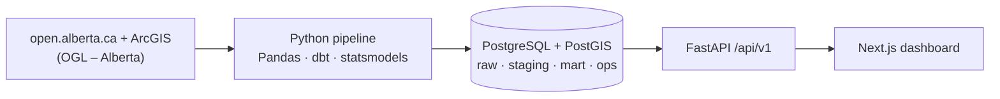

# Alberta School Capacity & Utilization Planning Platform

> **Status: Phase 0 of 8.** The data download, source mapping, database and API skeleton are built. The dashboard comes in later phases; see [docs/PROGRESS.md](docs/PROGRESS.md). Screenshots, setup and "What I learned" are added in Phase 8.

Capital planners need to know which Alberta school authorities and schools are running out of space, and where enrolment is heading. This platform brings 10 years of public enrolment, capacity and boundary data into one PostgreSQL warehouse, checks its quality, forecasts enrolment 3 years ahead, and serves it through a self-service dashboard.

## Architecture



More detail is in [docs/architecture.md](docs/architecture.md).

## Run what exists today

You need Docker and [uv](https://docs.astral.sh/uv/).

```bash
make setup     # install backend deps, create .env
make data      # download 24 public source files into data/raw/
make dev       # PostgreSQL + PostGIS and the API: http://localhost:8000/docs
make test      # backend tests
```

## Data sources

All from the Government of Alberta under the [Open Government Licence – Alberta](https://open.alberta.ca/licence).

- [Student enrolment by school, authority and grade level](https://open.alberta.ca/opendata/student-enrolment-by-school-authority-and-grade-level), 2016-17 to 2025-26
- [School jurisdiction schools with their total capacity](https://open.alberta.ca/opendata/list-of-albertas-school-jurisdiction-schools-with-their-total-capacity-for-the-school-year), 2023-24
- [Public](https://geospatial.alberta.ca/titan/rest/services/Education_Maps/edu_public_schl_auth_bound_2025_group_public/MapServer) and [separate](https://geospatial.alberta.ca/titan/rest/services/Education_Maps/edu_separate_schl_auth_bound_2025_group_public/MapServer) school authority boundaries, 2025
- Optional: [Edmonton Public Schools school locations](https://azimuth.epsb.ca/server/rest/services/Hosted/Schools__2025/FeatureServer), with its own terms

[docs/source_mapping.md](docs/source_mapping.md) describes every file's columns and how the files join.

## Known limitations (so far)

- Capacity is published for **2023-24 only**. Utilization for other years is an estimate and is labelled as one.
- The capacity file has no school codes, so it joins by name (99.7% of rows match).
- Boundaries exist for public and separate authorities only.
- The publisher removes First Nation schools from the enrolment files.
