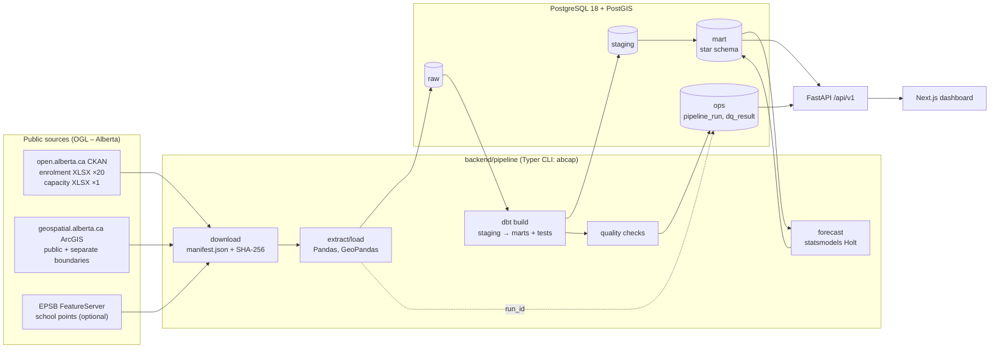

# Architecture



**Status (Phase 1):** built so far: download, extract/load into `raw` (Pandas, GeoPandas), the independent row-count check, `ops.pipeline_run`, Compose (db and backend) and `/api/v1/health`. dbt, quality checks, forecasts and the dashboard follow in Phases 2 to 6.

### One pipeline run

```mermaid
sequenceDiagram
    participant CLI as abcap run
    participant Log as ops.pipeline_run
    participant Raw as raw.*
    CLI->>Log: insert step "running" (own transaction)
    CLI->>Raw: BEGIN; TRUNCATE; INSERT rows (source_file, source_row, run_id)
    alt success
        CLI->>Raw: COMMIT
        CLI->>Log: status success, rows_in, rows_out, per-file details
    else error
        CLI->>Raw: ROLLBACK (previous load kept)
        CLI->>Log: status failed, root-cause message
    end
    CLI->>Log: verify_raw_counts: source files (openpyxl/JSON) vs table counts
```
